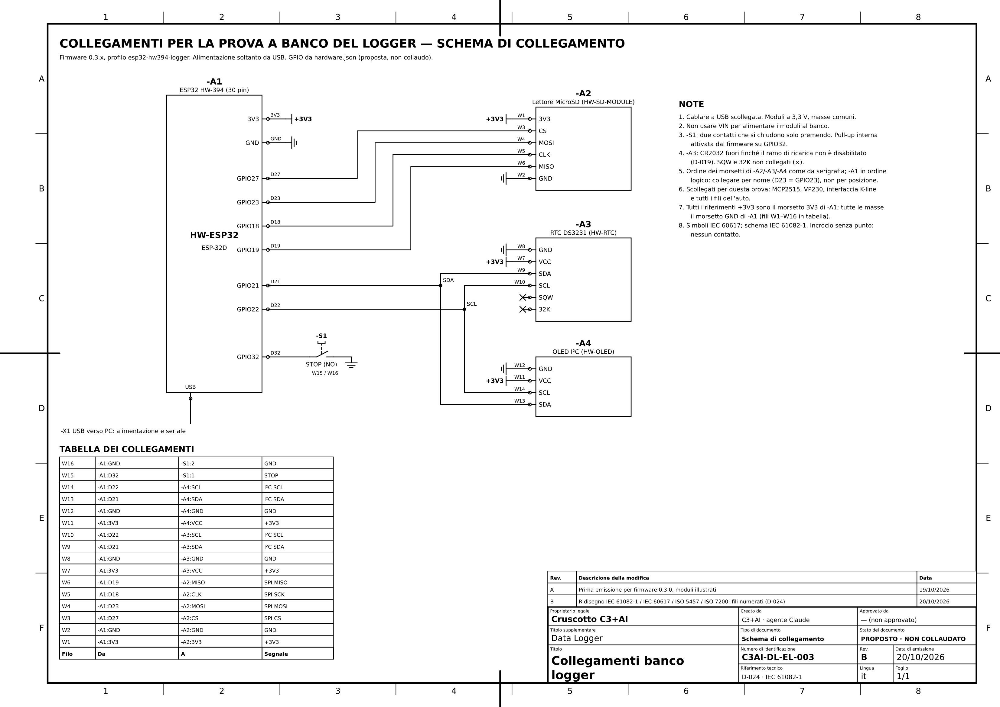

# Collegamenti per il caricamento e la prima prova del logger

**Cruscotto C3+AI / Data Logger** — C3AI-DL-EL-003, revisione B, 20/10/2026.
Stato: proposta coerente con firmware 0.3.x e hardware.json; non collaudo fisico.
Decisioni D-004, D-009, D-010, D-015, D-019, D-020 e D-024.

[Sorgente SVG](collegamenti-banco-030.svg). Rigenerare con
`python tools/genera-collegamenti-banco.py`; PNG ottenuto renderizzando l'SVG.
Rev. B (D-024): schema di collegamento IEC 61082-1, moduli come elementi con i
morsetti nell'ordine della serigrafia documentata (ESP32 in ordine logico), fili
numerati W1–W16 con tabella dei collegamenti sul foglio. Non sono footprint.
Foto effettive consultate nel [dossier](hardware-photos/README.md):
ESP32 HW-394 e SD/OLED/RTC ricevuti il 19/10/2026.

## Cablaggio a USB scollegata

| Modulo | Pin serigrafato sul modulo | ESP32 HW-394 |
| --- | --- | --- |
| Lettore SD (HW-SD-MODULE) | 3V3 | 3V3 |
| Lettore SD | GND | GND |
| Lettore SD | MOSI | GPIO23 / D23 |
| Lettore SD | CLK | GPIO18 / D18 |
| Lettore SD | MISO | GPIO19 / D19 |
| Lettore SD | CS | GPIO27 / D27 |
| RTC DS3231 (HW-RTC) | VCC | 3V3 |
| RTC DS3231 | GND | GND |
| RTC DS3231 | SDA | GPIO21 / D21 |
| RTC DS3231 | SCL | GPIO22 / D22 |
| OLED (HW-OLED) | VCC | 3V3 |
| OLED | GND | GND |
| OLED | SDA | GPIO21 / D21 |
| OLED | SCL | GPIO22 / D22 |
| Pulsante STOP normalmente aperto | Un contatto | GPIO32 / D32 |
| Pulsante STOP | Altro contatto | GND |

GND comune a tutti i moduli. SDA e SCL condivisi fra RTC e OLED, senza incrociarli.
Non usare VIN per alimentare questi moduli nel banco. RTC SQW/32K e GPIO33 liberi.
Sul pulsante a quattro piedini usare due contatti che si chiudono solo premendolo,
non due piedini già collegati internamente. La pull-up GPIO32 è attivata dal firmware.
Se il pulsante non è ancora disponibile, lo STOP si può comandare dalla seriale.

Per il primo avvio il RTC può restare **senza pila**. La CR2032 si inserisce dopo
la disabilitazione del ramo di ricarica D-019, non presunta effettuata.
La proposta alimenta SD, RTC e OLED a 3,3 V: non dichiara misurati assorbimento,
pull-up o compatibilità dei singoli moduli. Nessuna modifica alle verifiche inventariate.

MCP2515, VP230, interfaccia K-line e tutti i fili dell'auto rimangono scollegati.
Questa tavola serve alla prova USB con `esp32-hw394-logger`, non all'installazione
sul veicolo. Il profilo veicolo usa altre interfacce, documentate nel README firmware.

## Passo successivo

Dopo il cablaggio e prima dell'alimentazione verificare i nomi sulle serigrafie.
Poi si può caricare il profilo banco su COM3. Nessun caricamento eseguito nel
preparare questo disegno. SD non formattata né cancellata dal firmware.
Attendere SALVATO prima di togliere alimentazione dopo una registrazione.

Disegno e documenti inclusi nel salvataggio di progetto del 20/10/2026;
per lo stato pubblicato fa fede il commit del repository.
