# Archivio fotografico hardware

| Cartiglio del dossier | Valore |
| --- | --- |
| Progetto | **Cruscotto C3+AI** |
| Sottoprogetto | **Data Logger** |
| Documento | C3AI-DL-PH-001 |
| Revisione | D — 20/10/2026 |
| Stato | Identificazione visiva; esiti elettrici separati nel registro MCP2515 |

Foto già fornite dall'utente, recuperate dai Download e archiviate qui per
consultarle anche nelle sessioni future. Consultare queste immagini e
[l'inventario](../hardware-inventory.md) prima di chiedere di ripetere una foto.
Non sostituire un modulo perché la sua documentazione non era stata archiviata.

Le immagini sono evidenze sorgenti: non sovrapporre disegni o cartigli ai dettagli
originali. Il cartiglio appartiene a questo dossier; gli schemi derivati conservano
il proprio cartiglio. Le copie pubblicate hanno EXIF/XMP/IPTC e commenti rimossi
**senza ricompressione dei pixel**. Gli originali integrali sono conservati soltanto
localmente nella cartella ignorata `.tools/hardware-photo-originals/`.
[manifest.json](manifest.json) conserva nomi sorgenti e SHA-256 di origine/archivio;
il preflight controlla presenza e integrità delle copie versionate.

## HW-IMU-LSM6DSO — STEVAL-MKI196V1, fronte e retro

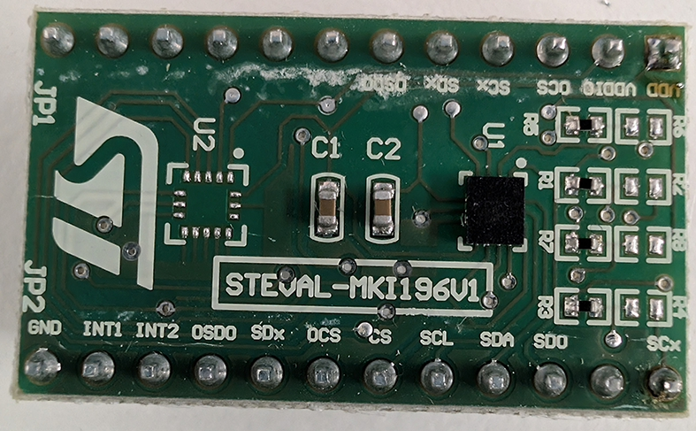

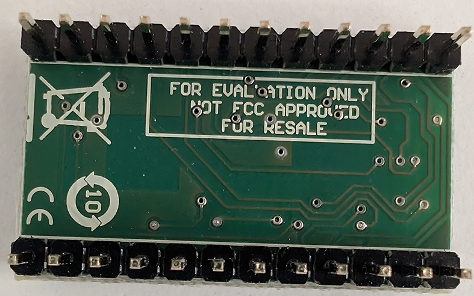

Foto dell'utente del 28/10/2026, all'arrivo dell'ordine Farnell. Sigla STEVAL-MKI196V1
serigrafata. Piedino 1 = piazzola quadrata accanto a VDD; numerazione DIL antioraria
vista dal lato componenti: 1 VDD, 2 VDDIO, 3 OCS, 4 SCx, 5 SDx, 6 OSDO (7-12 senza nome),
13 GND, 14 INT1, 15 INT2, 16 OSDO, 17 SDx, 18 OCS, 19 CS, 20 SCL, 21 SDA, 22 SDO, 24 SCx
(16-18 e 24 passano da resistenze/ponticelli R1-R8). Il modulo arriva con le strip
maschio già saldate. Misure dell'utente con il calibro: scheda 18,5 × 30,9 mm, passo 2,54 mm,
interasse tra le file 15 mm. La marcatura del chip U1 non è leggibile in foto.

## HW-CAN-MCP2515 — fronte e dettaglio

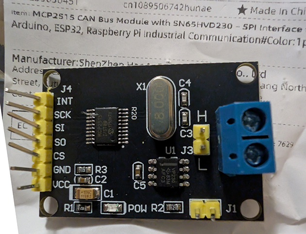

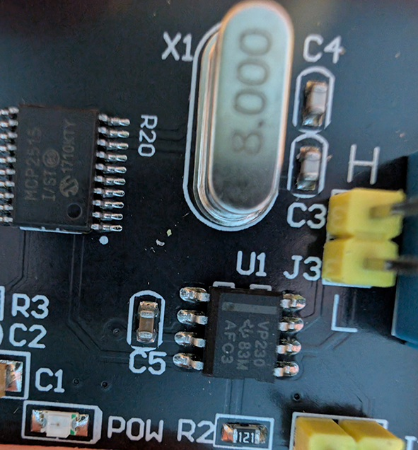

Si vedono il controller MCP2515, il quarzo con indicazione 8.000, la marcatura
VP230, i terminali H/L e le etichette SPI/alimentazione. Le sigle non certificano
la tensione interna o la compatibilità elettrica. J1 e J3 vanno identificati:
non presumere che siano terminazioni o selettori di alimentazione e non spostarli
alla cieca. Il retro non è presente in questo archivio.

## HW-CAN-VP230 — fronte e dettaglio

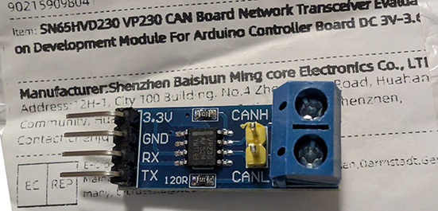

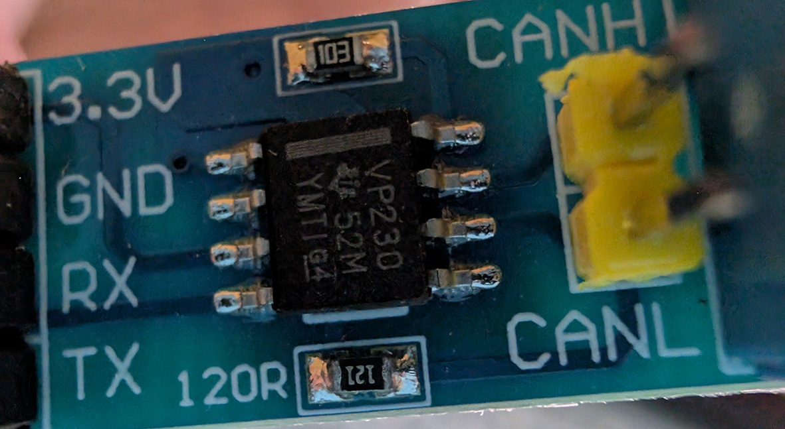

Visibili serigrafie 3.3V, GND, RX, TX, CANH/CANL e marcatura VP230. La resistenza
con codice 121 e serigrafia 120R indica un valore nominale, non ancora misurato.
Non confondere il connettore giallo CANH/CANL con un ponticello da cortocircuitare.

## HW-ESP32 e basetta a morsetti

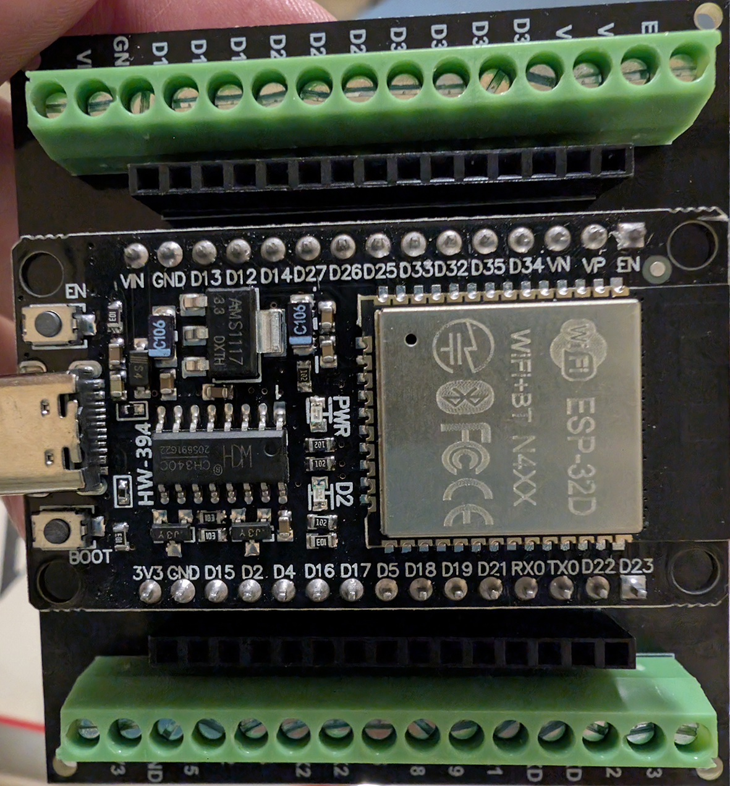

Serigrafie HW-394 / ESP-32D e basetta di espansione a morsetti visibili.
La continuità tra morsetti e socket non è stata verificata. Usare nomi GPIO,
non posizioni dedotte dalle illustrazioni dello schema generale.

## HW-MULTIMETER — UNI-T UT210E

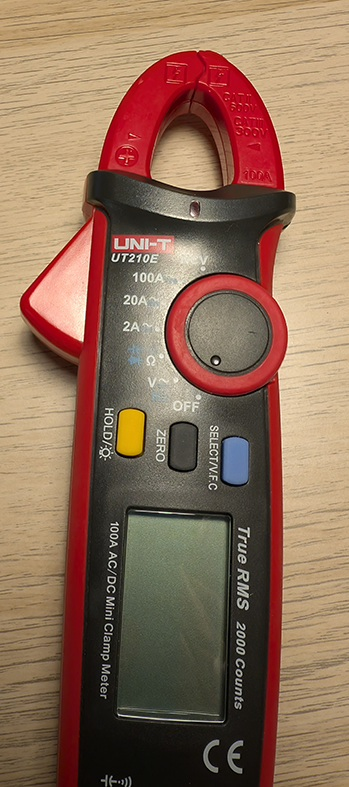

Modello identificato visivamente dalla foto tester.jpg fornita dall'utente.
Funzioni e misure vanno selezionate in base ai simboli effettivamente mostrati
dal display. Per le misure di resistenza sul modulo si usano i puntali,
non la pinza amperometrica. L'identificazione non certifica taratura o puntali.
[Manuale del produttore](https://meters.uni-trend.com/download/ut210e-user-manual/).

## Evidenze mancanti

Non sono archiviate foto del retro dei moduli. Il tester è ora identificato;
le sue prese inferiori non sono visibili nell'immagine fornita.
Chiedere una vista aggiuntiva solo se necessaria per una misura specifica;
non richiedere nuovamente le sei immagini già disponibili qui.

## HW-SD-MODULE, HW-SD-CARD, HW-OLED e HW-RTC — arrivo

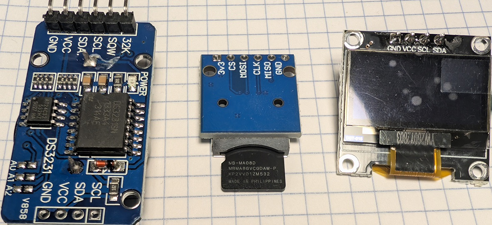

Foto del 19/10/2026: a sinistra RTC marcato DS3231SN, al centro lettore
MicroSD con scheda Samsung inserita, a destra OLED con GND/VCC/SCL/SDA.
Il modulo definito batteria e l RTC: nessun UPS aggiuntivo identificato.
Retro RTC e OLED non mostrati; nel lettore SD manca la vista del lato opposto.
Nessun collaudo o tensione ammissibile dimostrati dalla sola foto.

## HW-DASH-DISPLAY — scheda display 5″, retro e fronte

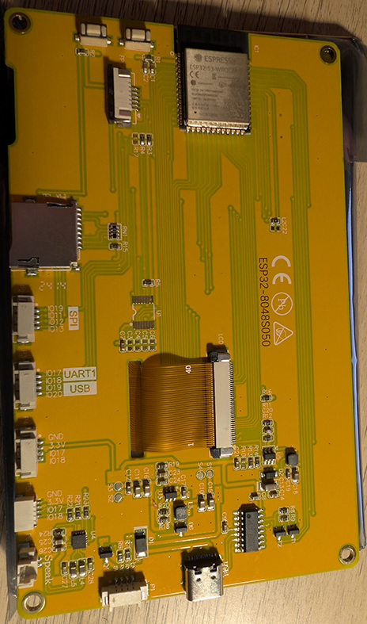

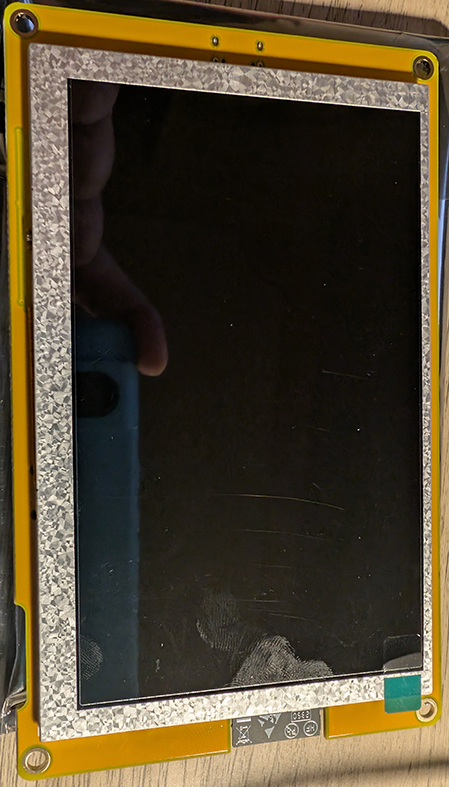

Foto del 20/10/2026 (D-026), fornite in chat a bassa risoluzione. Retro:
serigrafia **ESP32-8048S050**, modulo Espressif ESP32-S3-WROOM-1 (lettura confermata dall utente),
slot MicroSD, USB-C, due pulsanti, cavo flat verso il pannello, connettori
serigrafati SPI, UART1 IO17/IO18, USB IO19/IO20, due GND/3.3V/IO17/IO18 e Speak.
Non leggibili: sigla di memoria del modulo, revisione PCB, controller touch ed
etichetta sul fronte. Manca una vista ravvicinata del modulo; nessuna misura.
