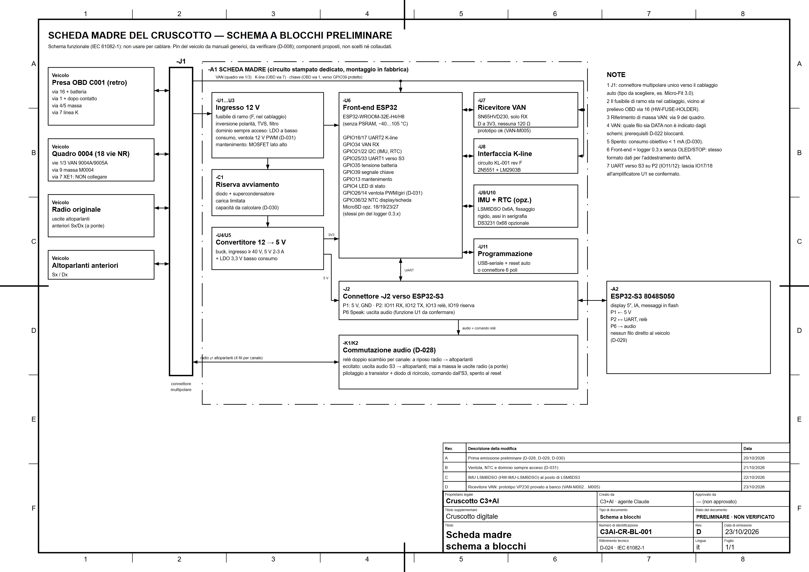
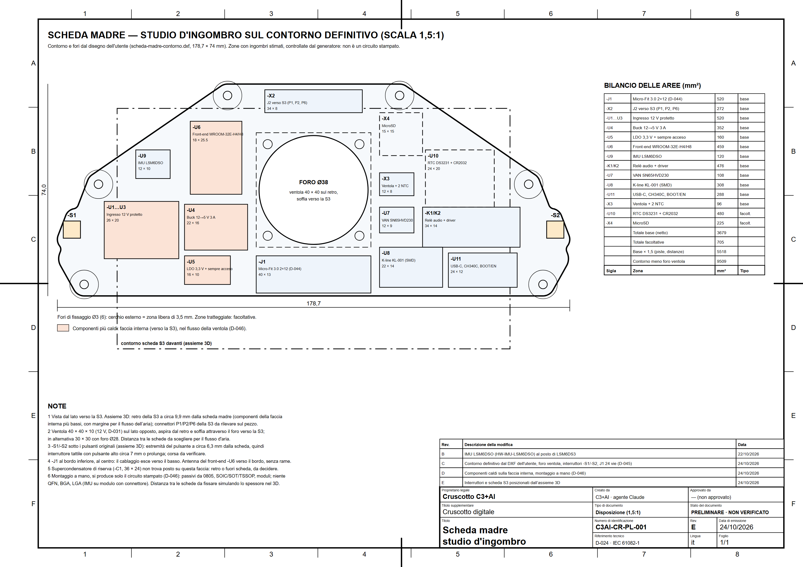
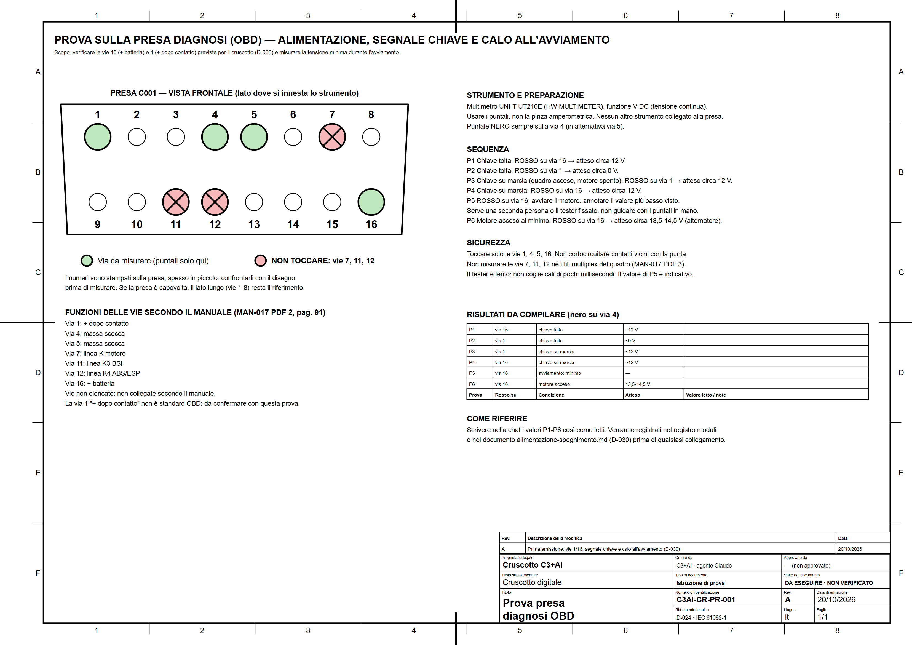
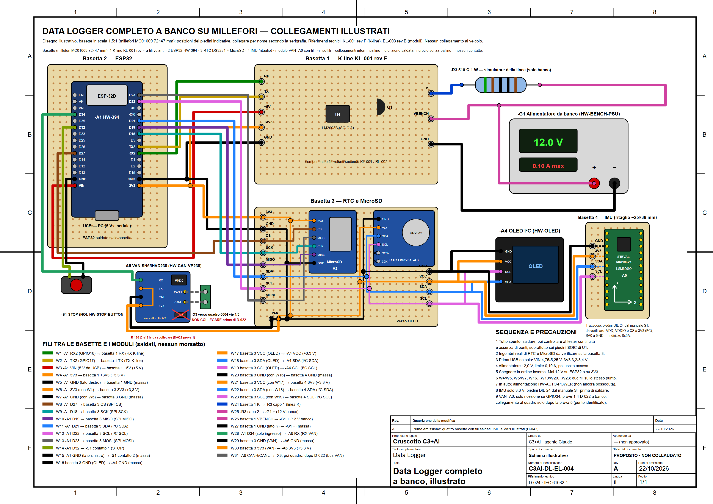
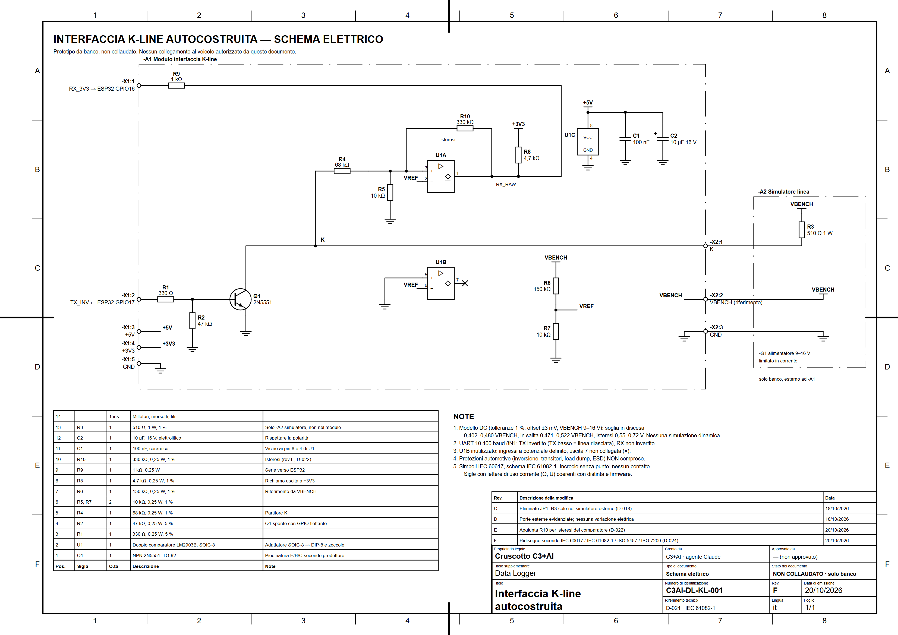
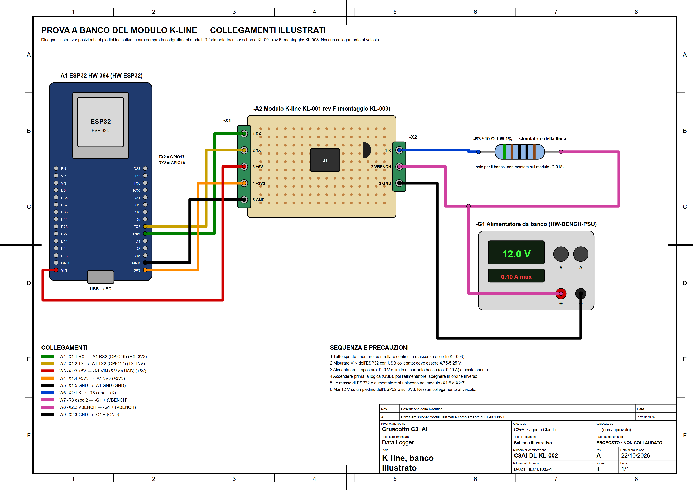
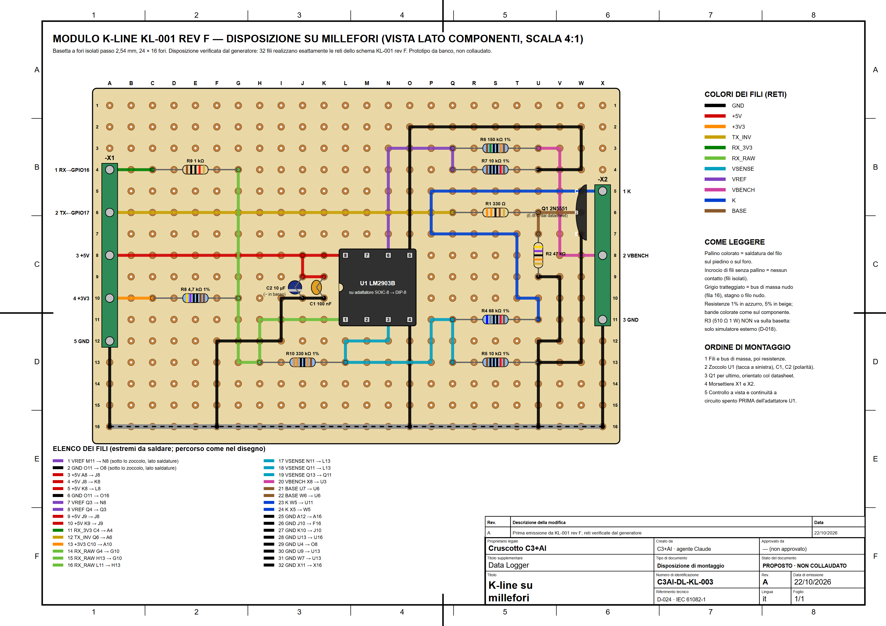
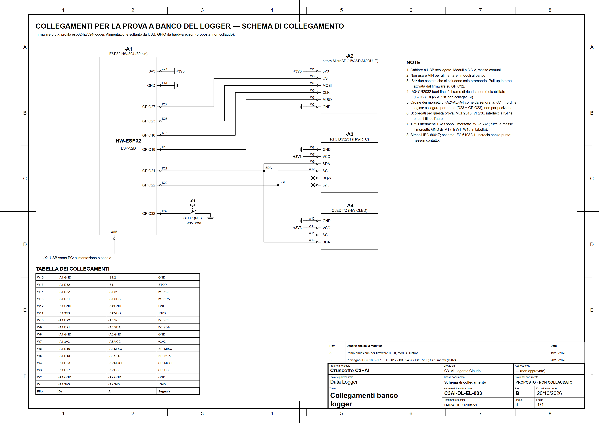
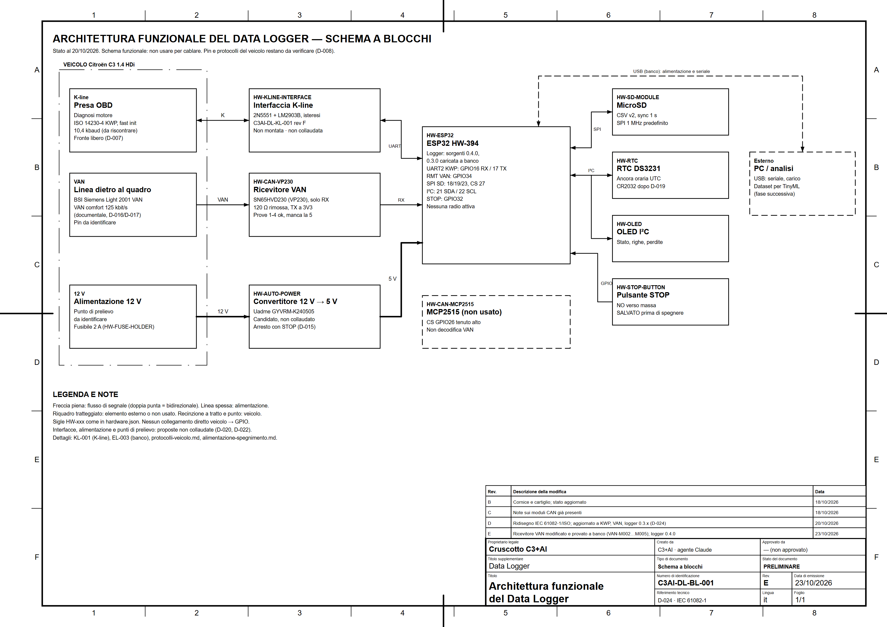
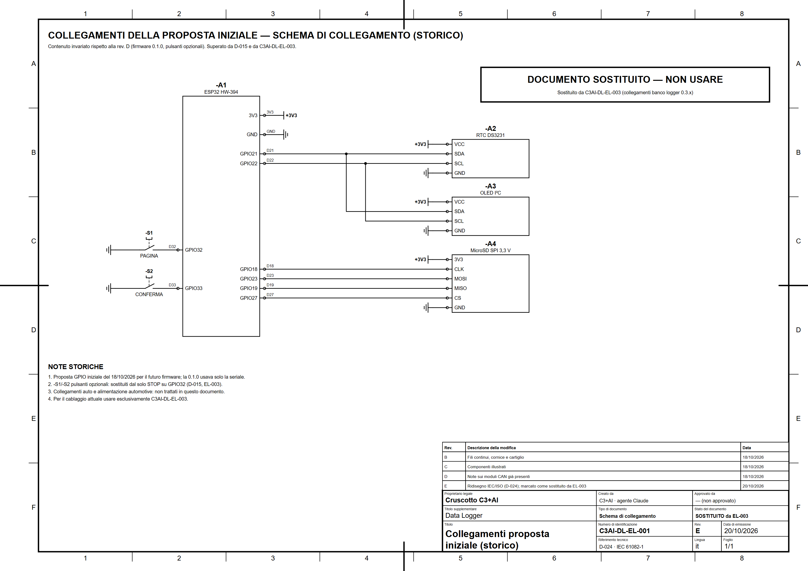

# Disegni del progetto — Cruscotto C3+AI

Tutti i disegni e le infografiche del progetto in un'unica cartella. Aprendo questa
cartella su GitHub compaiono qui sotto le anteprime: si clicca un'immagine per vederla
grande.

- **File `.png`** (in questa cartella): l'immagine da guardare o stampare.
- **File `.svg`** (in [`sorgenti/`](sorgenti/)): la stessa tavola in formato vettoriale,
  generata dagli script in `tools/`; serve per modificarla e resta nitida a qualsiasi
  ingrandimento. Non va aperta per la consultazione normale.

Codici: `DL` = Data Logger, `CR` = Cruscotto; `BL` schema a blocchi, `EL` collegamenti,
`KL` K-line, `PR` istruzione di prova, `PL` disposizione. Ogni tavola ha il proprio
cartiglio con revisione e stato (D-009, D-024).

## Cruscotto

### CR-BL-001 — Scheda madre, schema a blocchi (rev C, preliminare)
Architettura della scheda madre: alimentazione, front-end, interfacce, audio. Documento: [scheda-madre.md](../cruscotto/docs/scheda-madre.md).

[](CR-BL-001_scheda-madre-blocchi.png)

### CR-PL-001 — Scheda madre, studio d'ingombro (rev B, preliminare)
Zone dei componenti sul contorno della scheda S3 (137 × 84 mm).

[](CR-PL-001_scheda-madre-ingombro.png)

### CR-PR-001 — Prova sulla presa diagnosi OBD (rev A, eseguita: OBD-M001)
Vie 16/1/4/5 e calo all'avviamento, con tabella da compilare.

[](CR-PR-001_prova-presa-obd.png)

## Data Logger

### DL-EL-004 — Data Logger completo a banco su millefori (rev A, proposta)
Tutti i moduli disegnati come appaiono: ESP32, K-line, RTC con pila, MicroSD, IMU LSM6DSO, OLED, modulo VAN (solo ricezione), STOP e alimentatore da banco; fili saldati tra le basette, numerati W1…W31 (D-042).

[](DL-EL-004_logger-completo-millefori.png)

### DL-KL-001 — Interfaccia K-line, schema elettrico (rev F)
Schema tecnico IEC del modulo K-line. Documento: [kline-autocostruita.md](../data-logger/docs/kline-autocostruita.md).

[](DL-KL-001_schema-kline.png)

### DL-KL-002 — K-line, collegamenti illustrati della prova a banco (rev A)
ESP32, modulo, alimentatore da banco e resistenza del simulatore disegnati come appaiono.

[](DL-KL-002_kline-collegamenti-illustrati.png)

### DL-KL-003 — K-line su millefori (rev A)
Disposizione dei componenti e dei fili sulla basetta, con elenco foro per foro.

[](DL-KL-003_kline-millefori.png)

### DL-EL-003 — Collegamenti a banco del logger (rev B)
SD, RTC, OLED e pulsante STOP sull'ESP32 HW-394. Documento: [collegamenti-banco-030.md](../data-logger/docs/collegamenti-banco-030.md).

[](DL-EL-003_collegamenti-banco-logger.png)

### DL-BL-001 — Architettura funzionale del Data Logger (rev D)

[](DL-BL-001_architettura-data-logger.png)

### DL-EL-001 — Collegamenti della proposta iniziale (rev E, storico)
Sostituito da DL-EL-003; conservato per tracciabilità.

[](DL-EL-001_collegamenti-iniziali-storico.png)

## Rigenerare un disegno

```powershell
python tools/genera-kline-millefori.py           # scrive disegni/sorgenti/DL-KL-003_kline-millefori.svg
python tools/render_png.py disegni/sorgenti/DL-KL-003_kline-millefori.svg   # anteprima in disegni/
```

Le foto dei componenti restano in [`data-logger/docs/hardware-photos/`](../data-logger/docs/hardware-photos/README.md).
